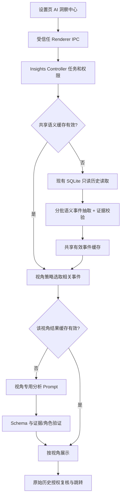

# Jojo Agent — AI 多视角洞察中心 MVP 优化设计

> 版本：v1.0（产品与技术设计）  
> 日期：2026-10-25  
> 项目：[zxt6991-source/jojo-agent](https://github.com/zxt6991-source/jojo-agent)  
> 建议仓库路径：`docs/Jojo-Agent-Insights-MVP-Optimization.md`  
> 状态：**设计方案，尚未实施**  
> 核心原则：**按需洞察、零聊天侵入、共享语义、证据可追溯**

## 1. 目标与结论

在桌面版设置页新增「AI 洞察中心」入口，以现有「交流脉络」能力为底座，通过不同分析视角对用户授权范围内的历史对话进行分析：发现思考变化、反向检验假设、考虑后续影响、定位信息盲区、澄清价值取舍及回顾行动反馈。

**明确不做**：在正常聊天中插入分析提示、不随每轮对话触发额外模型调用、不静默建立心理画像、不修改 Memory、不自动把模型推论写成用户事实。

### 1.1 产品价值

| 用户问题 | 对应视角 | 成果呈现 |
|---|---|---|
| 这段时间聊了什么、怎么变的？ | 交流脉络 | 主题图、时间线、变化证据 |
| 如果我的核心假设是错的？ | 逆向思考 | 假设、反例、失败条件与检验建议 |
| 这个选择之后还会发生什么？ | 二阶思考 | 一级/二级影响链及不确定性 |
| 我可能遗漏了什么？ | 思维盲点 | 缺失信息、被忽略的利益相关方及验证问题 |
| 我在不同决策中看重什么？ | 价值澄清 | 有出处的取舍线索和可能的价值冲突 |
| 哪些是想法，哪些真的执行了？ | 行动复盘 | 意向→决定→用户报告已完成的状态与待确认事项 |

截图中的 CBT、MBTI 不直接纳入首版：涉及敏感心理解释、过度人格标签化的风险较高。以后如增加，需使用非诊断型措辞，并单独设计同意与安全规范。

## 2. 仓库现状与复用边界

截至本方案编写时，已确认的相关代码：

| 模块 | 已存在能力 | 改造策略 |
|---|---|---|
| `apps/desktop/src/renderer/ConversationMapPage.tsx` | 范围、任务、进度、取消、图表与原文跳转 | 保留并改为洞察中心内的一个视角 |
| `apps/desktop/src/renderer/ConversationMapDiagram.tsx` | 图形展示 | 复用至脉络及二阶影响链，避免强绑通用卡片 |
| `apps/desktop/src/worker/conversation-map-service.ts` | 历史处理与 AI 分析 | 分离共享语义抽取和脉络特定整理 |
| `apps/desktop/src/worker/conversation-map-controller.ts` | 会话范围授权、任务取消、结束时复核 | 抽象为通用洞察任务控制，不削弱既有检查 |
| `apps/desktop/src/main/ipc/conversation-map-ipc.ts` | 可信 Renderer IPC、超时与资源限制 | 新增 insights IPC 或逐步整合，旧接口保持兼容 |
| `packages/storage/src/sqlite-conversation-map.ts` | SQLite 分页读取、主分支、授权过滤、出处查验 | 共用只读仓储；不绕过当前作用域过滤 |
| `packages/contracts/src/conversation-map.ts` | V2 事件、状态、变化、证据校验 | 将可共享的语义事件契约独立复用 |

**注意**：`ConversationMapResultV2` 是脉络展示结果，不应直接当作所有视角唯一原料，因为可见节点裁剪可能丢失关键信息。共享缓存存储的是经验证的语义事件集合，而不是已经裁剪的思维导图。

## 3. 范围与阶段

### P0：首个可发布版本

- 设置页「AI 洞察中心」入口。
- 可选范围：最近 7 / 30 / 90 天；个人主对话 / 当前项目（项目不可用时隐藏）。
- 视角入口：交流脉络（复用已有）＋逆向思考、二阶思考、思维盲点。
- 用户点击某视角才触发生成；支持状态、进度、取消、失败重试。
- 洞察卡片显示：结论、依据、推测/假设类型、可验证问题。
- 逐条证据点击查看原文并跳转；权限不足与原文删除时显示失效状态。
- 共享语义结果可复用；保持同一时间只运行一个分析任务。

### P1：第二阶段

- 价值澄清、行动复盘。
- 结果缓存与历史报告管理、报告删除、Markdown 导出。
- 自定义开始/结束日期和主题过滤（需要额外评估授权与成本）。

### P2：之后再考虑

- 自定义分析视角与用户 Prompt。
- 视角结果对比、周期性更新（明确另行授权）。
- 心理学探索视角（严格避免诊断、固定人格断言）。

## 4. 页面与交互

### 4.1 设置页

```text
设置
├─ 模型 / 权限 / Memory / ...
└─ AI 洞察中心                →
```

不会在聊天输入框、消息气泡或正常流式返回流程增加入口和额外提示。

### 4.2 洞察中心首页

```text
┌───────────────────────────────────────────────────────┐
│ ← 设置     AI 洞察中心                        历史报告 │
│ 选择不同视角，从历史对话中发现更多线索                 │
├───────────────────────────────────────────────────────┤
│ 时间范围  [7天] [30天·默认] [90天]                    │
│ 数据范围  (●) 个人主对话   ( ) 当前项目              │
│ 数据说明：仅分析所选范围，可能消耗模型额度             │
├───────────────────────────────────────────────────────┤
│ [交流脉络]        [逆向思考]        [二阶思考]         │
│ [思维盲点]        [价值澄清 P1]     [行动复盘 P1]      │
└───────────────────────────────────────────────────────┘
```

### 4.3 单视角结果页面

```text
← 返回洞察中心     逆向思考 · 最近30天     [重新生成]

分析完成：共读取 158 条有效对话轮次；存在截断项 8 条

[主题筛选：全部主题 v]

┌ 洞察卡片 ─────────────────────────────────────────────┐
│ 核心假设：本地推理长期更便宜                           │
│ 分析性质：[原文归纳] + [AI 提出的反向假设]              │
│ 值得验证：计入显卡、电费和维护时间后，成本会如何变化？ │
│ 依据：[对话记录 A] [对话记录 B]                       │
└───────────────────────────────────────────────────────┘

[查看原文] [复制] [下一条]
```

**交互规则**：先显示价值最高的 3～5 张卡片，其余展开；空结果可以合法存在，不为凑数量编造洞察。分析范围发生变化时，清晰标注旧结果与当前选择不一致，禁止把旧结果当成最新。

## 5. 技术架构



**关键：共享的是语义抽取，而不是统一的通用分析结论。** 视角专用提示词只处理相关事件。若某视角对证据上下文有更高要求，可通过受权限保护的原文读取接口读取精确片段，但不能直接使用不受限的整库扫描。

### 5.1 推荐文件组织

```text
apps/desktop/src/
  renderer/insights/
    InsightCenterPage.tsx
    InsightResultPage.tsx
    InsightCard.tsx
    InsightEvidencePanel.tsx
  worker/insights/
    insight-controller.ts
    insight-service.ts
    insight-extractor.ts
    insight-validator.ts
    strategies/
      registry.ts
      reverse-thinking.ts
      second-order.ts
      blind-spots.ts
      values.ts
      action-review.ts
packages/contracts/src/insights.ts
packages/storage/src/sqlite-insight-cache.ts
```

无需一次性重构旧 `conversation-map-*`：先以兼容包装器共享 `readConversationMapPage()`、证据查询与部分事件抽取逻辑，跑通一个新视角，再逐步抽离公共函数。

## 6. 数据模型建议

采用 Zod 严格验证，下面为 TypeScript 结构示意（实际实现需明确 maxLength、数组上限、互斥字段）。

```ts
type InsightPerspective =
  | 'conversation_map'
  | 'reverse_thinking'
  | 'second_order'
  | 'blind_spots'
  | 'value_clarification'
  | 'action_review';

type ClaimNature = 'source_fact' | 'model_inference' | 'hypothesis' | 'suggestion';

type InsightGenerateInput = {
  requestId: string;
  scope: ConversationMapScope;
  range: '7d' | '30d' | '90d';
  perspective: InsightPerspective;
  currentSessionId?: string;
};

type InsightCard = {
  id: string;
  topicId?: string;
  title: string;
  explanation: string;
  nature: ClaimNature;
  uncertainty?: string;
  verificationQuestion?: string;
  supportingEventIds: string[];
  supportingReferences: MessageReference[];
};

type InsightResult = {
  version: 1;
  perspective: InsightPerspective;
  generatedAt: string;
  rangeStart: string;
  rangeEnd: string;
  scopeKind: 'project' | 'personal_main';
  analyzedTurnCount: number;
  analyzedSessionCount: number;
  truncated: boolean;
  omittedTurnCount: number;
  cards: InsightCard[];
};
```

### 6.1 中间层约束

- 引用 ID 必须由程序映射，不信任模型自行构造的最终消息引用。
- `source_fact` 需要对应原文证据；`model_inference` 必须标明“可能”；`hypothesis` 和 `suggestion` 不得在缓存中转化为历史事实。
- 原文引文必须能匹配真实消息文本；超出截断范围不得声称已验证。
- `decision`、`revision`、`action` 关于**用户**的状态，只能由用户消息支持；AI 曾经建议，不等于用户已执行。
- 二阶影响是可能性推演，不冒充真实因果。
- 未出现不代表用户没有做过；行动复盘统一显示“所选范围内未确认”。

### 6.2 策略接口

```ts
interface InsightStrategy {
  id: InsightPerspective;
  promptVersion: string;
  selectEvents(events: EvolutionEvent[]): EvolutionEvent[];
  analyze(input: {
    events: EvolutionEvent[];
    signal: AbortSignal;
  }): Promise<InsightCard[]>;
}
```

生产代码中建议将 `modelClient`、授权回源和结果验证作为明确依赖注入，而不是由策略任意访问数据库。并限制每次模型调用的事件数量、输出 token 与费用预算。

## 7. 各视角规则与 Prompt 设计

所有视角共享系统级约束：**仅分析授权且可见的历史文本；不能断言真实世界未核实状态；必须区分原文、推断、假设；不得分析出固定人格结论；缺证据时允许零条输出。**

### 7.1 交流脉络

复用当前 V2 的 `events`、`changes`、`insights`，强化“同一对象、同一维度”的比较验证。默认展示 4～8 个关键阶段；归并时保留被筛出的原始事件证据链。

### 7.2 逆向思考

输入优先级：明确 `decision`、`position`、`constraint`，避免对随意提问强行反驳。

Prompt 核心：

> 识别用户在特定决策中的可证实假设。逐条提出一个可信的反面条件、其可能导致的失败机制，以及如何最低成本验证。不得把反面条件写成已经发生的事实。每条至少绑定一个原始观点证据；无法定位观点时不输出。

### 7.3 二阶思考

输入优先级：用户明确的方案和决定。

Prompt 核心：

> 先列直接影响，再推演下一层影响，标注受影响对象、关键依赖条件和不确定性。只描述合理的可能路径，不虚构因果链和未来结果。若历史没有实际决定，使用“假如选择该方案”表述。

### 7.4 思维盲点

输入优先级：多轮讨论但核心约束或证据不足的主题。

Prompt 核心：

> 发现用户已讨论的选项和证据之间的缺口，提出可操作的补充问题。不能因为历史中没提到某因素，就断言用户从未考虑过；使用“所选聊天中尚未见到”。

### 7.5 价值澄清（P1）

归纳的是当前语境里的取舍线索，而不是人格标签。例如“在多次方案比较中优先考虑成本”，须列证据和反例，允许“无法判断”。

### 7.6 行动复盘（P1）

严格分开 `planned`、`decided` 与 `reported_done`。AI 的建议不能自动升级为行动；没有后续对话只能标为“未确认”，而不是“未完成”。

## 8. 缓存与失效

### 8.1 缓存层次

1. **共享语义缓存**：授权范围内、经验证的全部候选语义事件及来源；不是前端裁剪后的图。
2. **视角结果缓存**：某个共享语义版本下的视角分析卡片。

建议键：

```text
semanticKey = hash(
  userDataOwner, scope, rangeStart, rangeEnd,
  historyFingerprint, extractorVersion, schemaVersion
)

insightKey = hash(
  semanticKey, perspective, promptVersion,
  modelId, perspectiveSchemaVersion
)
```

`historyFingerprint` 需要包含授权范围内相关会话/消息的变更水位或等价可靠摘要；单纯使用会话数量不足以发现编辑和删除。项目路径必须采用现有规范化身份，不能依赖字符串前缀匹配。

### 8.2 失效与隐私

- 删除消息、修改会话归属、切换用户、变更范围、权限撤销时失效。
- 点击证据时重新进行当前授权与引用完整性检查。
- P0 优先使用**进程内、有限容量、可取消任务关联**的缓存；P1 如落 SQLite，增加 TTL、容量上限和“清空报告”入口。
- 不把洞察结果写入 Memory 或聊天消息；不允许 AI 推测污染长期记忆。
- 缓存和日志不得包含 API Key；避免记录完整敏感原文与 Prompt。

## 9. 运行控制与异常处理

| 情况 | 页面行为 |
|---|---|
| 无可分析对话 | 显示“所选范围内暂无足够历史内容”，允许修改范围 |
| 对话极少、没有高价值洞察 | 显示“未找到有充分证据的洞察”，不凑满卡片 |
| 超量或截断 | 展示实际分析量、遗漏量及限制说明 |
| 用户点击取消 | 终止当前模型任务，不落地部分已失效结果 |
| 未配置模型或额度不足 | 提示到模型设置页，保留筛选选择 |
| 历史发生变更 | 标记旧结果过期，重新授权并生成 |
| 证据已删除 / 授权撤销 | 不再展示原文，提示引用不可用 |
| 模型输出不符合 Schema | 至多有限次数修复或丢弃无效卡片，不能自动编造补丁 |
| 当前已有任务 | 只允许取消或完成后再发起下一个任务 |

应复用既有可信 IPC 的超时、请求 ID、取消信号与数据读取权限检查；与普通聊天任务隔离，避免页面分析阻塞消息回复。

## 10. 验收标准

### 10.1 功能验收

- [ ] 设置页可进入洞察中心，返回设置时正常保留导航状态。
- [ ] 正常聊天发送、流式回复、Memory 路径无新增洞察模型调用。
- [ ] 7/30/90 天与两个授权范围生效；无法选择未授权项目。
- [ ] 交流脉络现有能力与入口没有回归。
- [ ] 三个新视角可生成结构化卡片，能取消、重试。
- [ ] 同范围切换视角复用语义事件而不重复整批抽取（缓存有效时）。
- [ ] 每个明确声称来自历史的事实都能跳转到真实、当前可访问的原文。
- [ ] 即使模型返回 0 张卡片也能正确展示空状态。
- [ ] 时间范围变化、消息删除、权限变化能导致适当失效。

### 10.2 质量验收

- [ ] AI 提出的反例不会被当作用户观点。
- [ ] AI 曾给出的建议不会被当作用户已经执行的行动。
- [ ] 同一主题下不同对象、不同维度不会被误合并为“观点反转”。
- [ ] 二阶影响链不会声称未发生的未来结果已经实现。
- [ ] 思维盲点使用“所选聊天没有证据”，不评价用户能力或人格。
- [ ] 对低证据/冲突证据案例主动不输出确定性结论。

### 10.3 性能与成本验收

- [ ] 每次分析有合理的消息、事件、模型调用、输出 token 上限。
- [ ] 缓存命中时不重复执行完整语义抽取。
- [ ] 大量聊天下分页读取，不一次性将所有原文装载到 Renderer。
- [ ] 取消任务后不可继续更新过期页面或写入过期缓存。
- [ ] 记录非敏感指标：读取量、模型调用数、缓存命中率、失败阶段、取消率。

## 11. 实施任务拆分

| 顺序 | 任务 | 交付结果 |
|---|---|---|
| 1 | 抽取可复用的 V2 事件与引用校验代码 | 现有脉络测试持续通过 |
| 2 | 增加 `insights.ts` 契约、策略类型与单元测试 | 版本化 JSON Schema |
| 3 | 增加洞察控制器、进度事件、取消与超时 | 受信任 IPC 链路 |
| 4 | 实现共享语义事件缓存和失效判断 | 相同范围分析可复用 |
| 5 | 实现逆向思考策略、Prompt、验证器 | 端到端可生成并回源 |
| 6 | 复制框架实现二阶思考和思维盲点 | 三种新视角可切换 |
| 7 | 设计设置入口与首页、结果卡片和空态 | 完整桌面 UI |
| 8 | 引入场景评测与安全回归测试 | 达到质量门槛后发布 |
| 9 | P1 增加价值澄清、行动复盘、持久缓存 | 后续迭代 |

建议测试组覆盖：单会话与跨会话主题、用户推翻早期决定、AI 提案但用户未选择、计划但未执行、消息删改、项目权限变更、模型生成假引用、输入截断、纯闲聊以及敏感心理话题。

## 12. 设计决策记录

| 决策 | 采用方案 | 原因 |
|---|---|---|
| 页面入口 | 设置页独立「AI 洞察中心」 | 与聊天隔离，用户主动触发 |
| 视角引擎 | 共享语义事件 + 各自策略 | 降低重复费用，并维持一致事实底座 |
| 历史访问 | 复用当前安全 SQLite 读取 | 避免越权读取或误读隐藏/自动化会话 |
| 模型输出 | 严格 JSON / Zod 校验 | 不运行模型生成的任意图代码 |
| 心理相关 | 暂不纳入基础版 | 避免固定人格标签和医疗化解释 |
| 数据落地 | P0 内存缓存、P1 可选持久化 | 先验证使用价值，减少迁移复杂度 |
| 交互方式 | 先精简卡片，按需展开证据 | 避免图过密、输出粗糙和认知负担 |

## 13. 一句话产品定义

**Jojo Agent AI 洞察中心：基于用户主动选择的历史聊天，以可追溯的证据和多种思考策略，帮助回顾观点变化、挑战假设、发现遗漏、理解取舍。**

