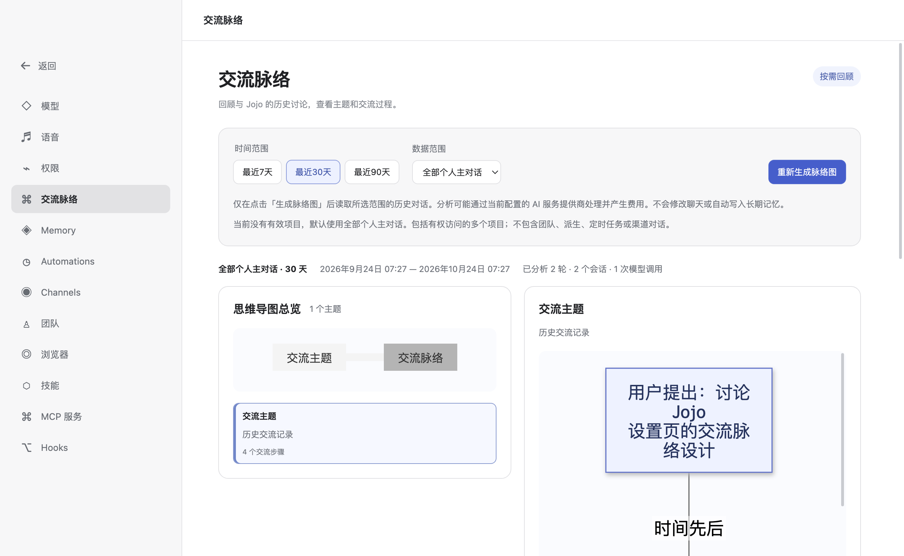

# 交流脉络（Desktop MVP）

打开「设置 → 交流脉络」，选择最近 7、30 或 90 天以及数据范围，再点击「生成脉络图」。生成会使用当前配置的辅助模型；仅打开页面或切换筛选条件不会调用模型。

生成完成后，左侧思维导图及主题列表展示主要讨论主题，右侧展示所选主题的交流流程。点击步骤可查看出处，再通过「查看原始对话」回到对应消息。切换主题只读取本次结果，不会再次调用模型。修改筛选条件后需重新生成。

## 数据范围

- 当前项目：根据当前会话在后端保存的项目身份及规范化目录匹配，不能读取其他项目。
- 全部个人主对话：由 Desktop 设置页主动选择，包含当前用户可见的普通主对话。
- 排除 Team、Spawn、Scheduler、Channel、内部消息、工具结果、附件正文及未提交或废弃分支。
- 只读取 Runtime SQLite 中持久化的 main 可见历史，不修改聊天、Memory 或数据库结构。
- 原文查询重新检查当前会话权限、主路径及本次结果的引用白名单。删除或变更范围后的记录不可继续访问。

## 运行方式与限制

分析采用分页读取、分批结构化摘要与主题归并。模型返回 JSON，经结构、引用、角色与时间校验后绘图。Mermaid 只接收程序生成且转义的文本，采用严格安全模式；图形加载失败时仍可使用主题与步骤列表。

一次最多分析 800 轮，超过上限会提示缩小范围；一级主题最多 12 个，每个主题最多 20 个步骤。页面显示分析轮次、会话数、模型调用次数及省略的步骤数。原文或结果被裁剪时会明确提示。本功能为回顾摘要，AI 建议不代表用户已经执行，相关讨论也不代表因果关系。

支持进度、取消及重试，离开页面会取消任务。生成结果仅保存在当前页面和受限的进程内状态中，不自动缓存、同步、定时更新或写入长期记忆。暂不支持自定义日期、导出图片、节点编辑或 Server API。

历史分析质量取决于当前配置的辅助模型。离线测试覆盖功能链路与安全边界；真实模型归纳质量需结合实际对话进一步评估。
