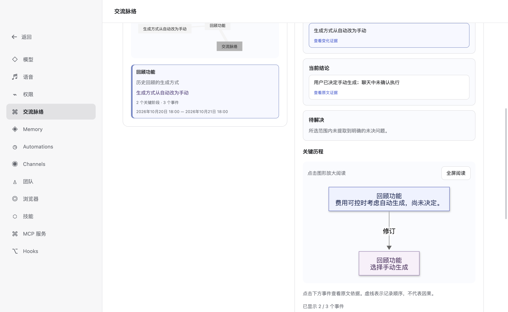
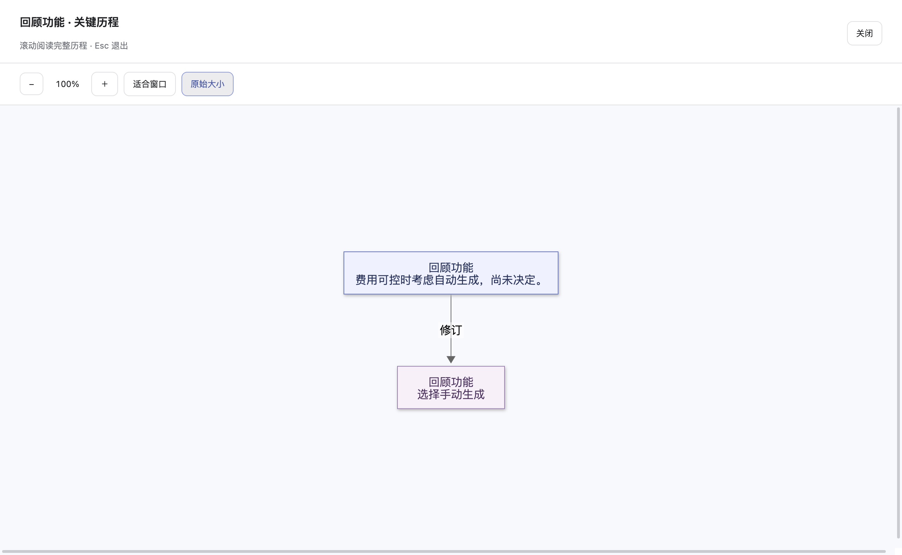

# 交流脉络（V1.1）

打开「设置 → 交流脉络」，选择最近 7、30 或 90 天以及数据范围，再点击「生成脉络图」。生成会使用当前配置的分析模型（utility model）；仅打开页面或切换筛选条件不会调用模型。

生成完成后，主题总览展示讨论重点和有证据的关键变化。主题详情提供「关键变化 / 当前结论 / 待解决」，默认展示最多 8 个关键阶段。有更多事件时，可在同一列表中展开其余已保留事件或收起，不重复展示；全部事件已显示时不提供展开入口。只有一次简短讨论或缺乏前后证据时，可以没有变化。

点击「关键历程」图形或「全屏阅读」，可在占满应用窗口的阅读器中查看。默认按原始大小显示，支持放大、缩小、适合窗口、滚动和 Esc 退出；退出后焦点回到打开入口。预览不会把窄图强行拉宽。图和事件卡片直接呈现要点正文，需要时保留简短对象标题，不展示日期、角色状态、分类维度或「AI 摘要」标签；正文已点明对象时省略重复标题。已核对的简短摘要完整展示，过长原文摘录用省略号标识；日期、角色、状态及前后变化说明在证据详情中查看。普通连线以虚线表示记录顺序，不重复标注「时间先后」，真实修订等关系仍保留文字。全屏、缩放和展开事件不会调用模型。

点击事件或洞察可查看经过原文子串验证的精确摘录、日期及用户 / AI 角色。变化洞察同时列出前后两端的证据；点击出处核对原文，再通过「查看原始对话」回到对应消息。切换主题或展开事件只读取本次结果，不会再次调用模型。修改筛选条件后需重新生成。

例如，用户早期表示「考虑自动生成」，后来明确表示「决定改为手动生成」，详情可呈现这项修订并附两条原文。若仅有 AI 建议或用户说「打算实施」，不会显示用户已执行。

## 数据范围

- 当前项目：根据当前会话在后端保存的项目身份及规范化目录匹配，不能读取其他项目。
- 全部个人主对话：由 Desktop 设置页主动选择，包含当前用户可见的普通主对话。
- 排除 Team、Spawn、Scheduler、Channel、内部消息、工具结果、附件正文及未提交或废弃分支。
- 只读取 Runtime SQLite 中持久化的 main 可见历史，不修改聊天、Memory 或数据库结构。
- 原文查询重新检查当前会话权限、主路径及本次结果的引用白名单。删除或变更范围后的记录不可继续访问。收到历史变更通知或回查时发现来源不可用，会清除旧图及相关结论，需手动重新生成。

## 运行方式与限制

分析采用分页读取、分批语义事件抽取、主题归并和同一对象 / 同一维度的跨会话比较。模型只提出候选事件与变化，程序验证引文、角色、状态、时间和权限后形成结果。事件的基础正文和证据保留来源的精确摘录，变化说明只展示前后表述。生成输出前还会重新读取引用消息，核对原始可见文本是否改变。比较失败时可降级为事实时间轴，不补造变化。Mermaid 只接收程序生成且转义的文本，采用严格安全模式；图形加载失败时仍可使用主题与事件列表。V1 结果保留兼容展示。

抽取要求一条事件只讲一个要点，保留条件、否定和计划状态，略去礼貌收尾与泛泛的实施建议。长回复中的多个有效建议拆成不同事件。候选简短摘要最长 120 字，须经过独立的模型核对请求，与精确引文及其来源上下文对照；通过后采用摘要，核对失败、超时、无法容纳完整上下文或超过预算时回退为原文摘录。正文保留「建议」「初步判断」「如果」「尚未」等有实际含义的限定，不因隐藏元信息而改变原意。该核对能减少失真，但不是语义正确性的保证，用户仍可核对原文。每批最多 20 个事件、32,000 字符，最多 16 批，每批最多两次尝试，调用计入页面统计。已有结果可直接采用精简展示，生成新的摘要仍需重新生成。

一次最多分析 800 轮，超过上限会提示缩小范围；一级主题最多 12 个，每个主题最多保留 20 个事件，默认图最多 8 个关键阶段。决策、修订、新约束及变化两端优先保留。页面显示分析轮次、会话数、模型调用次数及因去重、证据校验或展示预算未保留的候选事件数。原文或结果被裁剪时会明确提示。AI 建议不等于用户决定，计划不等于执行；「用户报告已完成」仅表示聊天中的自述。未找到执行反馈时使用「聊天中未确认执行」，不等同于现实中尚未执行。时间先后也不代表因果关系。

支持进度、取消及重试，离开页面或在生成中切换范围会取消任务；旧任务的延迟结果不会覆盖新状态。生成结果仅保存在当前页面和受限的进程内状态中，不自动缓存、同步、定时更新或写入长期记忆。暂不支持自定义日期、导出图片、节点编辑或 Server API。

分析调用通过 DeepSeek 官方 Chat Completions 接口时，会为本次请求关闭默认思考模式，让有限输出预算用于结构化结果；普通聊天的请求设置不变。空响应会自动重试一次；达到输出上限时会将本次请求预算从 8,192 提高到最多 16,384 token 后重试，仍受配置的模型最大输出上限约束。恢复与结构修复共用最多两次尝试，不切换模型或服务商，重试计入页面的模型调用次数。持续达到上限会显示明确提示，不会把截断结果当作完整分析。

DeepSeek 分析请求还会启用 JSON 输出模式。解析器接受纯 JSON 或单个完整的 JSON 代码块；不会从解释文字中猜测或修补内容。抽取提示使用正式 JSON Schema，校验失败时只反馈已知字段与规则（枚举错误会明确列出合法值），不回传模型原始错误内容。事件类型可规范化大小写、空格 / 连字符及界面上对应的中文类型名称；未知类型不会被猜成决定或执行。重试仍失败时，从两次输出中选择有效事件最多的一次，仅保留逐条通过字段、引用 ID、角色、会话和原文精确匹配的事件，并标记回顾不完整、计入省略数量。超出 40 条的批次、异常顶层字段和损坏 JSON 本身不会被放宽接受。

某个抽取批次在两次尝试后仍没有可用输出时，可继续分析其他批次。部分结果准确显示已分析及未分析轮数，明确提示结论仅基于成功分析的记录、可能遗漏后续变化；失败批次的原文不进入结果引用白名单。全部批次失败仍返回错误；有效的空事件数组算成功分析。取消、鉴权失败、超时及其他服务故障仍终止任务，不以部分结果掩盖。分析调用次数上限不变。

2026-10-25 已使用当前 DeepSeek Flash 对 12 轮虚构对话完成一次真实接口验证：抽取、归并、比较共 3 次调用，得到 9 个主题、12 个事件。该验证未读取用户聊天历史，只验证调用与校验链路，不代表实际历史的归纳质量已完成评测。

同日的可读性改进复测使用同组 12 轮虚构对话，经抽取及摘要核对共 2 次调用，将同一任务归为 1 个主题，保留 20 个事件（19 个采用简短摘要，1 个保留原文摘录），并保留手机端离线访问的未决问题；另有 5 个候选事件未保留，结果标记不完整。测试核对了条件、否定、计划与角色归属，未使用用户真实历史。模型输出有随机性，事件数量不是质量评分。

首版对中文和英文的决定、否定、计划与完成表述采用保守的明确措辞校验，未识别的表达可能被省略。暂不输出变化原因，避免将时间先后或相关性误写为因果。历史分析质量取决于当前配置的分析模型。离线测试覆盖功能链路与安全边界；真实模型归纳质量需结合实际对话进一步评估。
