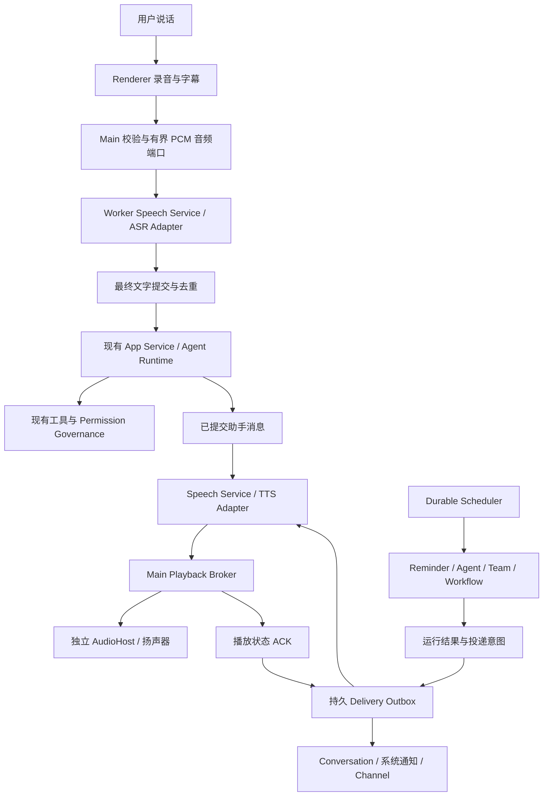
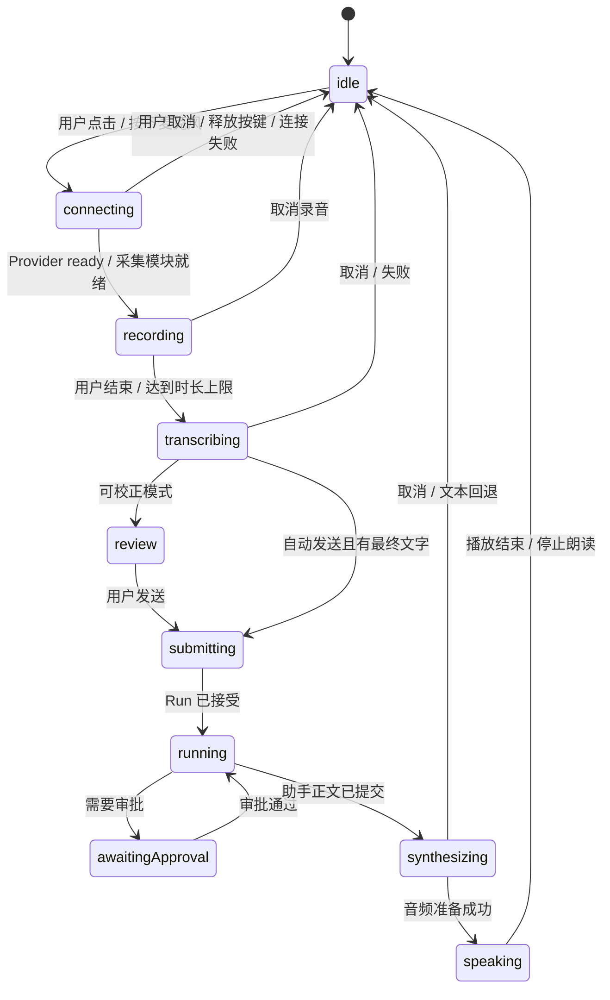

# Jojo Agent 语音对话与定时语音提醒最终技术方案（豆包 ASR + TTS）

> 日期：2026-10-12  
> 版本：v2.0，豆包首期实施基线，待开发  
> 适用范围：本仓库 Electron Desktop、共享 Runtime / Scheduler，以及后续 Headless Server 接入  
> 当前交付：技术方案文档；本文新增的接口、字段、模块和指标均为设计建议，不代表已实现。

## 1. 技术决策与交付范围

首期确定采用 **豆包 ASR 2.0 → 现有 Agent Runtime → 豆包 TTS 2.0**。先实现两个原生协议适配器，再接入按键语音对话与定时播报。将录音、转写、合成和播放作为独立的输入输出能力，保留现有会话、模型选择、工具调用、权限审批、记忆、Team 和 Workflow 链路。

定时语音提醒接入 **Durable Scheduler 的 delivery 层**。增加不调用模型的 `reminder` Target，让“十分钟后提醒我喝水”在到期后直接产生固定提醒内容；已有 Agent / Team / Workflow 的执行结果也可通过同一条语音投递链路播报。

首期以桌面端和普通话为主，兼顾中英混合。语音服务独立配置，不要求用户更换现有文字模型。本版替代 v1.0 的泛化服务选型与 WebM 采集草案；确定首期 PCM 采集、按键期间 ASR 上传、最终回复完整 MP3、固定提醒预缓存。连续对话、实时字幕和双向 TTS 按 P2 实施。

| 阶段 | 用户能力 | 交付边界 |
|---|---|---|
| P0：验证关键平台能力 | 设置页录音 / 转写 / 试听验证 | 验证实际 Electron 安装包、所选服务的中文表现、隐藏窗口播放与麦克风授权 |
| P1：可发布基础版 | 按住或点击说话；识别后发送；助手语音回复；到点提醒；任务结果播报；停止 / 重播 | 完整的文本回退、播放队列、投递状态、托盘常驻及故障恢复 |
| P2：连续语音对话 | 进入语音模式后连续多轮；实时字幕；自动断句；插话打断 | VAD、流式 ASR、句级 TTS、回声处理、会话状态同步 |
| P3：可选扩展 | 原生实时语音、远程播放设备、Channel 语音消息、本地语音模型 | 各自按能力开关发布；不作为 P1 前置依赖 |

P1 的“支持语音对话”指用户说话、Agent 处理、助手播报、多轮继续说话。自然插话和同时听说属于 P2 / P3 的体验升级。

## 2. 当前实现与缺口

本节以 2026-10-12 的仓库代码为准。旧设计文档中的“当前问题”可能已经过时，不作为实现状态的判断依据。

| 模块 | 已有能力 | 本次需要补齐 |
|---|---|---|
| Desktop 对话 | Renderer → Preload → Main → Worker；`startTurn` / `cancelTurn`；Runtime Run 和审批 | 录音入口、语音任务控制、精确关联会话和 Run 的语音事件 |
| 消息 / 模型协议 | `StartTurnInputSchema` 接受文字、图片、文件；现有 `ModelRequest` / `ModelEvent` 没有语音链路 | ASR 输出转换成普通文字输入；音频走独立通道 |
| Provider | 文字模型协议配置、流式文本输出、安全存储密钥 | ASR / TTS 独立适配器及能力检测；不能由文字模型兼容性推断音频兼容性 |
| Scheduler | once / interval / 带 IANA 时区 cron；租约、misfire、并发策略、运行历史 | `reminder` Target；语音 Delivery；按目的地持久化的投递记录 |
| Schedule Delivery | `conversation`、`notification`、`channels` 配置；已有对话写入和 Channel 路径 | `notification.enabled` 当前没有完整系统通知实现；没有语音播放实现 |
| 会话结果存储 | Desktop 正文通过 Runtime SQLite 保存；部分投递可持久排队 | 以已提交助手消息作为播报来源；不新增另一份会话正文 |
| 桌面生命周期 | Main 启动 Utility Process；非 macOS 关闭所有窗口后退出；退出时杀 Worker | 托盘、显式“后台运行”、独立 AudioHost、休眠恢复和锁屏策略 |
| Headless Server | Agent-only Scheduler；REST + JSON WebSocket；控制租约和幂等 | 远程语音协议、音频传输、授权播放设备；服务端本身没有桌面扬声器 |
| Channel | Telegram / 飞书 Adapter；入站 `voice: false`；出站统一内容模型没有专门的 voice 类型 | Channel 音频能力需单独扩展，不能直接宣称已有语音消息支持 |

关键代码入口：

- [桌面启动与生命周期](../apps/desktop/src/main/bootstrap.ts)、[Preload](../apps/desktop/src/preload/preload.ts)、[桌面契约](../packages/contracts/src/desktop.ts)、[跨进程契约](../packages/contracts/src/desktop-ipc.ts)。
- [Scheduler 契约](../packages/contracts/src/scheduler.ts)、[Scheduler 类型](../packages/scheduler/src/types.ts)、[Engine](../packages/scheduler/src/engine.ts)、[对话投递](../packages/scheduler/src/delivery/conversation-delivery.ts)。
- [Desktop Scheduler 装配](../apps/desktop/src/worker/scheduler-runtime.ts)、[Server Scheduler 装配](../apps/server/src/scheduler-runtime.ts)、[Scheduler SQLite](../packages/storage/src/sqlite-schedule-store.ts)。
- [Provider 配置](../packages/contracts/src/persistence.ts)、[JsonConfigStore](../packages/storage/src/index.ts)、[版本清单](../packages/contracts/src/build-compatibility.ts)、[架构约束](../scripts/check-architecture.mjs)。

需要在语音投递落地前一起修正的可靠性缺口：

1. Engine 重启恢复只补投递 `deliveryStatus=pending` 的终态 Run；终态已经写入但还未写 pending 的崩溃窗口，以及 failed 投递，不能假设会自动重试。
2. `deliverRun()` 读取最新 Schedule；Run 只有 `targetSnapshot`，没有投递目的地和文案快照。编辑或删除任务后，旧 Run 的待投递内容需要明确处理。
3. 对话投递虽使用固定消息 ID，但重试会重新生成 `createdAt`。Runtime 校验完整消息内容时可能出现冲突；消息 ID 固定不等于投递端到端幂等。
4. 单一 `deliveryStatus` 无法说明“对话已到、语音失败、一个 Channel 仍在重试”。需要分别记录各目的地状态。

现有 Channel Adapter 的 `delivered` 还可能仅表示请求已进入 Channel Outbox，分块发送也不能凭首块状态代表全部完成。因此新语音状态不能直接套用现有聚合字段的含义。Server 无 dataDir 时使用内存 ScheduleStore，也不能视为可重启恢复的持久部署。

## 3. 用户体验与行为约定

### 3.1 语音对话

输入区增加麦克风按钮，支持“按住说话”和“点击开始 / 点击结束”。首次使用进入一次语音设置，引导测试输入设备、转写服务、音色与播放。录音时显示波形、时长和明确的停止按钮。

提供两种提交方式：语音对话模式在最终转写成功后自动发送；语音输入模式将文字放回编辑框，由用户校正后发送。默认先使用可校正模式，用户可切换并保存偏好。识别为空、只有噪音或请求失败时不启动 Agent。

助手的文本回答始终可见；自动朗读为独立开关，用户也能点击单条消息的“朗读”。P1 长回答使用确定性规则取可读前段，最多 600 字符，全文保留在对话中；LLM 摘要不是首期依赖。审批出现时，播报“需要你确认一项操作”，并展示原有审批 UI。

“停止朗读”只停止声音；“停止任务”调用现有 Run 取消链路。已执行的外部副作用不会因停止声音或取消 Run 自动撤销。

### 3.2 定时语音提醒

示例交互：

```text
用户：十分钟后语音提醒我喝水。
助手：已设置，今天 15:10 提醒你喝水，使用桌面语音播报。
到期：系统通知 + “该喝水了。” + 原会话中的提醒卡片。

用户：每天早上八点查今天的天气，用语音告诉我。
助手：每天 08:00（Asia/Shanghai）开始查询，查询完成后播报结果。
```

第二个场景必须说明“开始查询”与“完成后播报”的时间差。涉及工具或模型的任务不能承诺到期瞬间已经有结果。

创建回执明确显示触发时间、时区、播报方式、是否需要后台运行和过期处理。语音识别中的时间存在歧义时，在对话内澄清具体时间；不能把不确定的“十五 / 五十分钟”直接固化为任务。

固定提醒创建 / 编辑后立即请求预合成，并显示“语音已准备”或“语音准备失败，将保留文字提醒”。重复任务按下一次 occurrence 维护可用缓存；提前准备不提前执行任务，真正触发仍由 Scheduler 决定。初始建议固定提醒补播有效期为 10 分钟，动态任务结果为完成后 30 分钟，均在创建回执可见并允许修改。

Automations 页面增加“语音播报”“播报内容”“试听”“勿扰时段”“超过多久不再补播”。运行详情分别展示执行状态、系统通知状态、语音排队 / 播放状态和失败原因。

### 3.3 默认播放策略

| 场景 | 默认行为 |
|---|---|
| 正在录音 | 暂停自动播放；提醒进入队列，避免录下提醒音 |
| 正在听助手回答 | 提醒先排队；对话结束后播放，超时则只显示文本通知 |
| 勿扰时段 / 用户关闭语音 | 保留文字投递和运行历史；记录 `suppressed`，不重试制造噪音 |
| 锁屏 | 默认不朗读正文；解锁后只补播仍在有效期内的提醒 |
| 耳机拔出或输出设备变化 | 暂停并提示；避免敏感内容突然从扬声器播放 |
| 多个提醒同时到期 | 单个播放器串行；同一任务重复发生的过期提醒合并或跳过 |
| 用户点击停止提醒 | 该次播放结束；重播必须由用户主动发起 |

锁屏事件在支持的平台使用 Electron API；无法可靠判断时采用保守策略，要求用户主动播放。勿扰由应用维护，不承诺每个平台都能读取系统 Focus / 勿扰状态。

系统通知默认使用任务标题和短提示，完整正文在应用中查看；用户可主动开启正文预览。对话卡片保存实际结果，播放失败也能找到提醒内容。

## 4. 总体架构与包边界



建议新增 `packages/speech`，实现语音任务状态、文本整理、Provider 编排和队列规则；在 `packages/providers/src/speech/` 实现具体语音 API 适配。接口和 Zod Schema 放在 `contracts`。存储实现放在 `storage`；Desktop 的麦克风、系统通知、托盘和播放宿主保留在 `apps/desktop`。

| 层 | 职责 | 约束 |
|---|---|---|
| `contracts` | Speech 设置、任务 / 事件 / 音频资产引用、Provider Port、Playback Port、Scheduler 扩展 | 仅稳定类型和校验；不导入具体语音实现 |
| `speech`（新增） | ASR / TTS 协调、VoiceTurn 状态、正文整理、限额 / 取消 | 平台无关；通过契约端口注入 Provider、存储与播放能力 |
| `providers` | 豆包 ASR WebSocket / 二进制协议与 HTTP TTS；后续双向 TTS | Provider 的网络协议细节不进入 Agent Core |
| `storage` | 音频资产、投递记录、语音设置迁移 | 不把音频写进会话正文或 Agent 事件 |
| `scheduler` | 新 Reminder Dispatcher、投递意图、恢复与重试 | 不依赖 Electron，不直接调用扬声器 |
| `runtime-composition` / Host 装配 | 注入服务与契约端口 | 不让 `agent-runtime` 依赖 Speech 或 Electron |
| Desktop Main | 麦克风授权、资产入口、系统通知、播放仲裁、托盘、休眠事件 | 持有宿主能力；语音服务长期密钥不下发 Renderer |
| Desktop Worker | Speech 任务、Provider 调用、Scheduler Outbox 所有权、Run 关联 | 复用现有消息 / 审批链路 |
| Renderer / AudioHost | UI 与录音 / 专用播放 | Renderer 只导入 contracts；AudioHost 使用独立、最小 Preload |

`app-service` 当前依赖白名单只允许 `agent-runtime` 与 `contracts`。若需要在 App Service 提供语音入口，应注入定义在 contracts 的端口；不得直接导入 `speech` 包而破坏架构检查。P1 不需要改造 Agent 的模型循环。

## 5. 豆包 ASR + TTS 适配器：确定的接口与配置

### 5.1 首期服务与协议

首批研发锁定豆包原生语音服务，新增独立 `DoubaoAsrAdapter` 与 `DoubaoTtsAdapter`。它们使用语音控制台 API Key，不进入现有文字 `createProvider()` 工厂，也不修改文字模型协议枚举。新增 `createSpeechProvider()` 工厂，Provider Port 放在 contracts。

| 用途 | 首期确定接口 | 模型资源与行为 |
|---|---|---|
| P1 按键语音输入 | `wss://openspeech.bytedance.com/api/v3/sauc/bigmodel_nostream` | `volc.seedasr.sauc.duration`；ASR 2.0 小时版，录音期间上传，结束后取整句最终结果 |
| P1 回复 / 提醒合成 | `https://openspeech.bytedance.com/api/v3/tts/unidirectional` | `seed-tts-2.0`；一次提交可读文本，接收合成片段，生成完整 MP3 |
| P2 实时字幕 | `wss://openspeech.bytedance.com/api/v3/sauc/bigmodel_async` | ASR 双向流式；后续阶段启用 |
| P2 文本流 → 音频流 | `wss://openspeech.bytedance.com/api/v3/tts/bidirection` | TTS 双向 WebSocket；后续阶段启用 |

上表采用普通语音服务接口。方舟 Agent Plan 专属接口和专属 Key 属于其他产品，不能替换这里的 endpoint。[一句话 ASR](https://docs.volcengine.com/docs/DoubaoVoice/unidirectional-streaming-automatic-speech-recognition-websocket?lang=zh)、[HTTP TTS](https://docs.volcengine.com/docs/DoubaoVoice/unidirectional-streaming-text-to-speech-http?lang=zh)、[双向 TTS](https://docs.volcengine.com/docs/DoubaoVoice/WebSocketBidirectionalStreaming-V3?lang=zh)。

P1 的 ASR 虽然录音期间上传，但只在用户结束录音并得到最终结果后提交 Agent；没有连续监听、自动开始下一轮或自然插话。P1 的 TTS 先完整合成再播放，降低播放器与缓存的复杂度；短回复首音等待与 P2 流式首音指标分别测量。

### 5.2 鉴权、资源与音色

ASR / HTTP TTS 在 Host 加入以下请求头，`X-Api-Request-Id` 每个实际网络 attempt 生成新 UUID：

```text
X-Api-Key: <从安全存储读取>
X-Api-Resource-Id: <ASR 或 TTS 对应资源>
X-Api-Request-Id: <本次 attempt UUID>
Content-Type: application/json  # 仅 HTTP TTS
```

`resourceId` 同时表达服务版本与计费商品；ASR 的 `model_name=bigmodel` 和 TTS 可选 `req_params.model` 是不同层级的请求参数，不能互相替代。首期只接新版 API Key 鉴权，配置 UI 不要求旧版 App ID / Access Token，也不自动试探多套凭据。未来兼容旧鉴权时另加明确协议配置。[ASR 鉴权](https://docs.volcengine.com/docs/DoubaoVoice/unidirectional-streaming-automatic-speech-recognition-websocket?lang=zh)、[TTS 鉴权与参数](https://docs.volcengine.com/docs/DoubaoVoice/unidirectional-streaming-text-to-speech-http?lang=zh)。

TTS 首期使用预置 2.0 音色，不接声音复刻。用户从控制台音色库选择 speaker ID 并试听验证；示例 `zh_female_vv_uranus_bigtts` 来自官方请求示例，不代表所有账号均已开通。语音设置保存 speaker ID，不能把中文展示名直接发给接口。

### 5.3 ASR 输入与请求

P1 采集统一为 **16 kHz / 单声道 / 16-bit signed little-endian PCM**。每 200 ms 形成 6,400 字节音频包，在录音期间持续发送；松开后先发送最后剩余采样，再发协议尾包。不能把录完后的高速补发作为已保证能力。官方对包长 / 发包节奏的建议作为适配器联调依据。[协议与分包说明](https://docs.volcengine.com/docs/6561/1354869?lang=zh)。

参数首帧的业务 JSON：

```json
{
  "audio": {
    "format": "pcm",
    "codec": "raw",
    "rate": 16000,
    "bits": 16,
    "channel": 1
  },
  "request": {
    "model_name": "bigmodel",
    "enable_itn": true,
    "enable_punc": true,
    "enable_ddc": false,
    "show_utterances": true,
    "result_type": "full"
  }
}
```

这里 JSON 需由二进制编码器包装，不是向 WebSocket 直接发送一条 JSON 文本帧。默认不传 `audio.language`，使用该服务默认的中文 / 英文识别；设置页将其显示为“中文及中英混合”。明确语言或方言配置在完成验证后再开放。[音频与请求参数](https://docs.volcengine.com/docs/DoubaoVoice/unidirectional-streaming-automatic-speech-recognition-websocket?lang=zh)。

Renderer 用 AudioWorklet 采集设备的实际采样率，持续低通 / 重采样并量化到上述格式；不能假设 `getUserMedia({sampleRate: 16000})` 必然返回 16 kHz，也不能简单每隔几个采样取一个点。原文档的 MediaRecorder WebM 路径从首期移除：官方支持格式中未列 WebM，WebM/Opus 不能只改格式声明冒充 Ogg/Opus。首期不引入 FFmpeg 转码依赖。

### 5.4 ASR 二进制与最终结果

新增 `DoubaoAsrFrameCodec`，把协议处理隔离在 providers 中：

- 按 header 指定大小读取 version、type、flags、serialization 和 compression；协议整数为大端，PCM 采样为小端，二者分开处理。
- type 为完整请求、音频请求、结果或错误；只有相应 flag 表示有 sequence 时才读取序号，不能对全部包固定偏移。
- JSON / 音频 payload 按所选协议使用 gzip；长度计算压缩后的字节。解压结果有上限，畸形包直接终止。
- 接收端从最终包 flag 归一化 `final`；`utterances[].definite` 只表示分句确定，不能触发整轮 Agent。
- `result_type=full` 是累计全文快照，每次覆盖本请求文本，不反复追加同一段。

最新官方示例的 `code=0`、`is_last_package`、`payload_msg` 是 Python 示例解析后的包装。Node 适配器要先解码二进制，再从内部 `result.text` 取文字；不能等待裸 wire JSON 自己出现这些包装字段。官方公开解析代码仅用于协议旁证，不复用其中专属服务路径。[ASR 协议](https://docs.volcengine.com/docs/6561/1354869?lang=zh)、[官方解析代码](https://docs.volcengine.com/docs/ark/agent-plan-personal-voice-model?lang=zh)。

ASR `ready` 是“WebSocket 已 open 且参数首帧成功写出”的本地事件，不等待需要音频后才产生的识别结果。录音开始必须等 ready，冷连接期间显示 connecting，不计入录音时长、不采集用户语句。nostream 录音阶段可能没有识别文字，不能套用从建连开始的“首结果 / 文字 idle”超时；最终结果等待从尾包发出后计时。取消时停止采集、关闭连接、作废 generation；没有为普通 ASR 虚构独立 cancel 事件。中途网络失败不自动重放已上传录音，提示重录，不产生 Agent Run。

### 5.5 TTS 请求与完整 MP3

```json
{
  "req_params": {
    "text": "提醒你，下午三点半参加会议。",
    "speaker": "zh_female_vv_uranus_bigtts",
    "audio_params": {
      "format": "mp3",
      "sample_rate": 24000,
      "speech_rate": 0
    }
  }
}
```

P1 默认 MP3 / 24 kHz，`speech_rate=0`；UI 可调语速时直接使用经校验的服务参数范围，不把旧草案浮点 `speed` 未转换地发送。预置音色无需指定 `req_params.model`。首期只提交规范化纯文本，不启用 SSML、复刻、情绪指令或 provider 自定义 `additions`。[TTS 参数](https://docs.volcengine.com/docs/DoubaoVoice/unidirectional-streaming-text-to-speech-http?lang=zh)。

HTTP 返回的是含 `code` / `data` 的 JSON 音频片段，`data` 为 Base64。HTTP body 的一个网络 chunk 不等于一个 JSON 对象；`HttpTtsResponseDecoder` 增量处理 UTF-8 和完整 JSON 对象，再校验、独立 Base64 解码并按序追加，不能直接把整个 body 保存成 MP3，也不能跨对象拼接 Base64 字符串。

当前通用 HTTP 文档写明 `code=0` 成功，但没有明确整段结束帧及分隔合同。实施基线是正常完成 HTTP body、全部片段业务成功、无残留半截 JSON、非空且可解码的 MP3；P0 需用普通 endpoint 抓取一次脱敏真实响应锁定完成条件与测试夹具。若实际响应存在另一个结束码，先以该接口事实修订版本化 decoder；不能从专属 Plan / SSE 或 WebSocket 复制 `20000000` 当作已经确认的通用 HTTP 成功码。此项是上线前协议验收，不改变首期接口选择。

合成写入 `.part`，达到完成条件后原子 rename 并发布可播放资产。任何业务失败、超时、截断、取消都清理临时文件；AudioHost 只能读取 ready 资产。上游 Base64 仅在适配器内解码，Jojo 的 IPC / AgentEvent 不广播它。

### 5.6 设置与安全存储

```ts
type SpeechSettings = {
  enabled: boolean; // V1–V4 迁移后 false
  inputMode: 'review' | 'auto_send';
  autoReadReplies: boolean;
  provider: {
    id: 'doubao';
    protocol: 'doubao_speech_v3';
    secretRef: string; // 例如 speech.doubao.apiKey
    asr: {
      mode: 'utterance';
      resourceId: 'volc.seedasr.sauc.duration';
      audio: { format: 'pcm'; sampleRate: 16000; channels: 1; bits: 16 };
    };
    tts: {
      mode: 'http_complete';
      resourceId: 'seed-tts-2.0';
      speakerId: string;
      format: 'mp3';
      sampleRate: 24000;
      speechRate: number; // 默认 0；z.number().int().min(-50).max(100)
    };
  };
  playback: {
    volume: number; // 本地播放器 0…1，不混同服务 loudness_rate
    muteWhenLocked: boolean;
    quietHours?: { start: string; end: string; timezone: string };
  };
};
```

endpoint 来自代码内固定注册表，设置页只配置语音 Key、资源与音色，不开放任意 URL。首次启用验证 Key、两类资源权限及 speaker；缺失时不能保存 enabled=true。普通配置不保存 Key，不假设文字模型 Key 具备语音权限。

Main 通过现有 safeStorage 机制保存独立 speech secret 文件；Worker 接收受控配置快照与凭据版本，Renderer 只读 `hasKey`。Speech Broker 只解析自己的 `speech.doubao.apiKey` 引用，不读取其他工具或 Provider 的 secret namespace。Key 更新时取消旧请求、清理连接和刷新 Worker；日志保留 request ID / `X-Tt-Logid`，密钥、录音和全文不入日志。

连接只允许上述固定 HTTPS / WSS host、拒绝跨域重定向；新 WebSocket 客户端应在 Host 中显式配置 Headers、握手超时、消息大小和关闭逻辑。选择 `ws` 等 Node 客户端时正式声明生产依赖和类型，不依赖其他包偶然带来的传递依赖。[ws 官方项目](https://github.com/websockets/ws)。

ASR 上传用户主动采集的音频，TTS 上传可读正文；首次开启清楚展示这两条数据流，播放 UI 标识 AI 合成语音。中文识别率、音色与费用均用实际账号和项目样本核验，不把厂商宣传延迟或免费额度当作产品承诺。

## 6. 语音对话链路与状态机

### 6.1 P1 一轮对话

1. Main 验证语音开关、可信应用窗口和系统麦克风权限。Renderer 调用 `getUserMedia` 采集，仅请求音频，不请求摄像头或系统声音。
2. Main 建立绑定 captureId / session 的有界音频通道和 ASR 请求，Renderer 准备本地 AudioWorklet。Provider ready 后才进入 recording、显示“可以说话”并开始计时和 PCM 采集；connecting 时释放按键则取消该轮。录音期间持续转发给 Worker，支持最多 60 秒的一轮输入。
3. Worker 把音频按 200 ms 包发送豆包 ASR。用户结束后以同一有序通道排空剩余音频并发送尾包，等待最终结果；格式 / 大小不匹配、空录音或失败只更新语音 UI，不启动 Agent。
4. 最终转写进入编辑框或 `voice.commit`；后者在 Worker 以稳定的 `voiceTurnId` 去重，再调用现有 App Service 启动 Run。ASR partial 只用于字幕，不持久化、不调用工具。
5. 保存最终用户文字和输入来源关联。正文格式维持现有文本消息，新增可选 metadata 保存 `voiceTurnId`；PCM 缓冲在结束 / 取消后释放，首期默认不落盘原始录音。
6. Agent 继续使用现有模型、工具与治理。`JojoAppService.executeRun()` 已返回带 runId / sessionId / finalText / messages 的 `RunResult`；在 `turn-controller.ts` 捕获当前被丢弃的返回，仅对 completed 且有 finalText 的本轮结果触发 TTS 和统一 Playback Broker。
7. 播放结束回传 ACK；录音、Run、合成与播放有各自终态。TTS 失败不改变 Agent 的完成状态，文本回答继续可用。

### 6.2 状态与取消



以上是 UI 主状态，底层仍分别维护 Run 与 Playback 状态，不用单个枚举掩盖异步任务。

所有语音事件至少携带 `voiceSessionId`、`voiceTurnId`、`sessionId`、`generation`；已绑定后再携带 `runId` / `messageId` / `playbackId`。会话切换、停止、删除或重试时递增 generation，拒绝旧 ASR / TTS 请求的晚到结果。

当前 `cancelTurn` 只发送取消命令；`TurnTaskRegistry` 在旧任务仍占用会话时可能拒绝新任务。不能“发送取消后立刻提交下一句”。新增明确的取消完成信号：停止当前声音 → 请求取消 Run → 等待 Run 终态与本地 registry 释放 → 提交新句；超时则保留新句草稿并显示“上一任务仍在结束中”。

P1 用户主动开始录音时立即停止对话播报。若 Agent 仍在运行，则先保存录音 / 转写，新一轮等待旧 Run 结束，或由用户点击“停止任务并发送”。P2 自然插话时默认只停播放；取消 Agent 必须是明确的操作或经过配置的行为。

### 6.3 P2 连续对话

复用 P1 的 AudioWorklet 采集和重采样，将 ASR 切换为已验证的豆包双向流式接口，提供 partial / final；VAD 负责起止和静音阈值。参数需用普通话、短句、中英混合、风噪及耳机场景测试，不能把固定静音阈值当最终体验。

TTS 只消费稳定的可见助手正文片段，在同一豆包双向 session 内传入文本流并记录段号，不为每个 token 建立合成任务。工具规划文字或之后可能改写的输出不提前播报；完成后保留全文与实际播报进度。可复用带 sessionId / laneId / runId / sequence 的 `RuntimeEventEnvelope`；不能订阅当前缺少逐事件关联的全局 Desktop `text.delta` 直接出声。

启用采集端 `echoCancellation` / `noiseSuppression` 等约束，并检测可用能力；播报期间由 VAD 识别真实人声，再清空播放缓冲和取消未消费 TTS。设备不支持可靠回声消除时回退按键模式。

## 7. 音频传输、播放宿主与资源限制

### 7.1 控制与音频分开

当前 Desktop Worker 命令 / 消息有 16 MiB 上限，Server JSON WebSocket 默认 maxPayload 为 1 MiB。音频不能 Base64 放进 `AgentEvent`、`StartTurnInput` 或现有 Server 事件广播。

P1 使用独立 MessagePort 音频通道：每包携带 captureId / generation / sequence / Uint8Array，累计字节与时长受限。Main 从已验证的 begin 操作创建端口、绑定可信主窗口 / session / owner；不接受 Renderer 任意本地路径、下载 URL 或未经创建的 capture ID。

Main 通过 `speech.stream.attach` 控制消息把专用端口交给 Worker。控制消息继续校验，二进制数据在端口内独立校验，不进入当前 `postWorkerCommand()` / `WorkerCommandSchema` 的 JSON 大小计算。端口链路为 Renderer → Main → Worker → ASR Adapter，每轮单独创建，结束 / 删除 / 崩溃后关闭。

结束标记与音频使用同一有序数据通道，携带 lastSequence；Worker 确认前序包齐全且已经交给 Provider 后，才发送 ASR 尾包。逐块 ACK 与 Node WebSocket bufferedAmount 高水位协同限流；超过 2 秒积压或检测丢包时取消该轮并提示重录，不静默丢帧。

Electron 39 的 Main / Utility Process transfer 参数只支持 MessagePortMain，不承诺把 ArrayBuffer 放进 transferList 实现零拷贝。首期用有界结构化克隆即可；AudioWorklet → Renderer 可以转移 ArrayBuffer。合成输出使用不可猜测 `audioAssetId`，只传 ID / 元数据，播放时再验证 session / owner / 有效 token 和真实路径。

### 7.2 独立 AudioHost

增加只负责声音输出的 sandboxed 隐藏窗口，由 Main 管理 Playback Broker。对话朗读与提醒共用一个播放队列，避免两个窗口同时出声。AudioHost 不采集麦克风、不持有 Provider 密钥、不执行工具，也不复用完整 `DesktopApi`。

AudioHost 使用独立 Preload / 最小 IPC allowlist，校验 webContents、frame 和有效播放 token。当前 `assertTrusted` 只信任主窗口，不能为了 AudioHost 放宽成“全部应用窗口可信”。

音频由受控 `jojo-audio:` 协议或有界 Blob 提供；协议只读取已授权资产，按需支持 Range，不暴露任意文件。当前 [index.html](../apps/desktop/index.html) 没有 `media-src`；需为主窗口 / AudioHost 分别配置有限的 `media-src jojo-audio: blob:`，不扩大为任意远程媒体源。明确处理自动播放拒绝、音频解码失败、输出设备丢失和 AudioHost 崩溃。

### 7.3 建议初始限额

以下是产品初始值，均可通过受限配置调整，需根据实测收敛：

| 项目 | 默认限制 / 行为 |
|---|---|
| 单次录音 | 最长 60 秒；16 kHz PCM16 单声道为 1,920,000 字节；最多再允许 200 ms 尾包余量 |
| IPC 音频块 | 标准 6,400 字节；每包硬上限 256 KiB；ACK 窗口最多 8 包，禁止无限排队 |
| 采集格式 | P1 固定 PCM16LE / 16 kHz / mono；按设备真实采样率重采样 |
| Provider 消息 | ASR 单消息及解压后 JSON 初始上限 1 MiB；未知类型 / 长度越界拒绝；TTS 总音频初始上限 8 MiB |
| 单条助手自动朗读 | 最多 600 个字符；超长显示可继续朗读入口 |
| 单次提醒 | 硬上限 200 字符，建议文案不超过 80 字符；目标 10–30 秒，实际时长按音色 / 语速测试 |
| ASR 超时 | 连接 10 秒；用户录音最多 60 秒；尾包后最终结果 15 秒；不把录音时长计入 30 秒旧默认 |
| TTS 超时 | 响应头 10 秒、首片段 10 秒、片段 idle 10 秒、总合成 30 秒；分别计时且可取消 |
| 排队数量 | 最多 20 个待播放提醒；超过后保留文本并记录原因 |
| 音频临时文件 | P1 录音不落盘；TTS `.part` 成功 / 失败 / 取消后清理，崩溃遗留最长 1 小时并启动扫描 |
| 提醒音频缓存 | 最长 7 天、总配额 256 MiB、LRU 回收；支持一键清除 |

默认不保存原始对话录音，不将音频放入 Git 项目或会话导出；临时文件用最小文件权限。播报文字可能包含私人信息，缓存位于 app userData，关联源任务 / 消息删除。不要把文本明文嵌入文件名或日志。

## 8. Scheduler 扩展设计

### 8.1 固定提醒与结果播报

新增 Target 的概念接口：

```ts
type ReminderScheduleTarget = {
  kind: 'reminder';
  text: string; // 保存用户确认的固定文案，不执行模板代码
};

type ScheduleVoiceDelivery = {
  enabled: boolean;
  deviceId: string; // P1 local-desktop；预留后续已授权设备
  content: { kind: 'fixed'; text: string } | { kind: 'result'; maxChars: number };
  presetId?: string; // 引用语音设置，不保存 Secret
  expiresAfterMs: number;
};

// 在已有 ScheduleDelivery 中增加 optional voice 字段。
```

`ReminderScheduleDispatcher` 不创建 Agent Run，到期后产生确定的 ScheduleRun 结果。它仍通过 Scheduler 的 occurrence、租约、并发和 misfire 路径执行，使用稳定 execution ID，并能在重启时恢复其状态。`voice` 是投递方式，不是新的 Agent Target。

例如“十分钟后提醒喝水”保存 `target.kind=reminder`、固定文案和 once；“明早查天气后告诉我”继续保存 `target.kind=agent`，voice content 取结果。Reminder 本身无需 providerId / model / 项目目录；对话投递目的地仍由 `delivery.conversation.sessionId` 指定。

Reminder 默认 voice content 使用 `kind=result`，直接取 Target 的固定文案；若用户另设 fixed 播报文案，则在创建回执显示实际要播的内容，避免两个字段悄悄不一致。首次校验固定文案时应用 200 字符初始限额。

扩展时同时更新 Target 类型、严格 Schema、Dispatcher 注册、Target 验证器、schedule_* 工具解析 / 描述、Settings 表单、所有穷尽 switch、Server 能力校验及契约测试。特别补齐 `capability-manifest.ts` 的 targets、`server-protocol` 的 targets enum、Desktop `validateScheduleTarget` 的显式 reminder 分支，以及 Server 目前只接受 agent 的验证器。Headless Server 可执行 Reminder，但没有本地播放设备时应拒绝启用本地语音目的地，并说明可用投递方式。

### 8.2 内容与触发点

- 固定提醒按到期时间生成投递意图；提前合成并缓存音频可降低到点延迟，文案 / 音色修改会使缓存失效。
- Agent / Team / Workflow 默认在 completed 后播报结果。使用结果正文构造受限播报内容，不直接朗读任意工具输出或把 `resultPreview` 当完整正文。
- 简短纯文本可直接播报；Markdown、代码、表格、链接经确定性规则整理。需要摘要时单独记为可选任务，摘要失败回退“任务已完成，请查看结果”，不影响原任务成功状态。
- failed / interrupted 使用短提示；cancelled / skipped 默认不播报。`waiting_approval` 尚非终态，需单独监听审批事件生成一次短通知，不能等待现有终态 delivery 自动覆盖该场景。
- 提醒不会读取“是 / 好的”来自动批准文件写入、Terminal 或外部发送。P1 审批沿用现有 UI；未来语音审批需要独立、可审计的授权设计。

当前 `TargetExecutionSnapshot` 只有受限的 `resultPreview`。新增定义在 contracts 的 `ResultContentPort`，必要时提供稳定 `resultRef`，由 Host 根据 execution ID 读取已经提交的 Agent / Team / Workflow 结果，在终态与 Outbox 事务前固定受限播报 payload。Scheduler 只依赖该端口，不导入具体 App Service / Team 实现，也不拼接当前 UI 消息。正文读取失败使用“任务已完成，请查看结果”等固定回退，并记录原因；不能让在线摘要请求阻塞 Scheduler。Reminder 文案直接来自 `targetSnapshot`。

### 8.3 持久化与投递快照

在 Scheduler SQLite 新增 destination delivery / outbox 表。Worker 是 Desktop Scheduler 和 Outbox 的唯一写入协调者，Main 通过明确命令 claim / ACK。Channel 继续使用自己的可靠 Outbox，并用稳定 request ID 关联，避免重试生成新的发送请求。

```ts
type ScheduleDeliveryItem = {
  id: string;
  scheduleRunId: string;
  destination: 'conversation' | 'notification' | 'voice' | 'channel';
  destinationId: string;
  dedupeKey: string;
  payloadSnapshot: unknown; // 实现时按 destination 定义严格 Schema
  state: string; // 实现时定义严格枚举，见第 9 节
  attempts: number;
  nextAttemptAt?: string;
  expiresAt?: string;
  claimToken?: string;
  claimExpiresAt?: string;
  version: number;
};
```

创建 Run 时保存投递配置快照；形成投递意图时再固定实际内容、voice preset 的版本、稳定消息 `createdAt` 和目的地。建议唯一键为 `(scheduleRunId, destination, destinationId)`。Payload 以专门 Schema 校验，不能长期使用任意 `unknown` JSON。

**终态迁移与投递意图写入在同一个 Scheduler SQLite 事务完成。** 在 ScheduleStore 增加相应事务方法，让 Engine 状态迁移原子地产生 Outbox；避免仅在状态事件监听器中异步插表而留下崩溃窗口。对话正文写入 Runtime SQLite 属于另一次事务，依靠固定消息 payload / ID 和 Outbox 重试达成最终一致。

旧 Run 的投递不会使用修改后的新目的地。用户删除任务或关闭播报时，将尚未播放的 voice item 撤销；已经执行的 Run / 文本历史保留。播放前仍复核当前全局静音、锁屏、勿扰和设备授权，这些用户控制优先于快照。

原 `deliveryStatus` 为兼容字段；新增每目的地记录作为真实状态来源。语音仅进入队列不能标记“已播报”；系统通知 API 接受不代表用户已看见。聚合 UI 需能显示“部分投递成功”，不让一个目的地失败掩盖其他已完成目的地。

## 9. 提醒可靠性、重试与播放确认

### 9.1 音频投递状态

```text
pending → preparing → ready → claimed → playing → played
                         ↘ failed（可重试至有效期 / 次数上限）
                         ↘ suppressed / expired（不自动重试）
claimed / playing → uncertain（无法确认是否已发声）
playing → interrupted（用户停止，不自动重播）
```

Main claim 时获取版本和短期租约；AudioHost 准备播放后由 Worker 持久化 start ACK，再许可输出声音，结束时发送 played ACK。所有 ACK 带 item ID、claim token、playback ID 和 generation；过期 token / 重复 ACK 不能改变新一次投递。播放期间 Main 定期续租，初始建议租约 20 秒 / 5 秒续租；续租失败先停止本地播放并交由 Worker 标记不确定态，避免另一次 attempt 与旧声音并行。

Outbox 通过周期拉取和重启 / 获得调度租约后的恢复检查驱动；IPC push 仅用于唤醒拉取，不能作为唯一投递事实。新增恢复应覆盖后续 leader 接管，不能仅在首次 initialize 时扫描。固定提醒预合成 / 准备音频在后台进行，Scheduler 的终态处理只写投递意图，不等待整个声音播完。

即便采用以上握手，数据库提交和扬声器实际发声无法处于同一事务：崩溃可能发生在 ACK 前后，**不能承诺声音 exactly-once，也不能确认用户真的听到**。持久队列提供可恢复投递，播放侧去重控制重复。无法确认的 claimed / playing 标记 uncertain，默认不自动重播，保留通知和“点击重播”；可在后续提供用户明确选择的重播优先策略。

合成或下载失败可用指数退避重试，建议 1 / 5 / 15 秒、最多 3 次，并处理 Provider 的 Retry-After；超出有效期直接 expired。认证、无权限、无音频能力等永久错误不循环重试。播放途中设备故障或进程崩溃按 uncertain / interrupted 处理，不能套用 TTS 网络重试。

Speech Service 自身一次合成 attempt 不做隐式多层重试；提醒重试由 Outbox 唯一负责，对话试听 / 朗读失败由用户主动重试。豆包的同一错误码可能包含参数、并发或资源原因，需结合 HTTP 状态和受控 reason 分类；不能仅见某个码就重试。每次 Provider attempt 使用新 UUID，并关联同一 deliveryId；重复合成可能重复计费，未播放的半成品不能作为成功缓存。

### 9.2 离线、休眠与过期

Scheduler 的 misfire 控制“是否补执行”；voice 的 `expiresAt` 控制“结果现在是否还值得播报”，两者独立。过期基准明确：固定提醒按 `scheduledFor + expiresAfterMs`；任务结果按 `finishedAt + expiresAfterMs`，同时在卡片上显示原计划时间。

| 状态 | 产品行为与实现边界 |
|---|---|
| 窗口在后台，进程仍运行 | Main / Worker 调度，AudioHost 播放；不依赖聊天页面是否挂载 |
| 主窗口关闭，启用后台运行 | 隐藏主窗口并保留托盘、Worker 和 AudioHost；提供明确退出入口 |
| 应用完全退出 | 本机不能实时播报；下次启动按 misfire 和有效期处理；UI 明确提示 |
| 电脑休眠 / 关机 | 不承诺唤醒设备；resume / 启动时恢复运行和投递，过期提醒不连续补播 |
| 网络断开 | 预缓存固定提醒仍可播放；未缓存 / 动态结果若合成失败则文本回退 |
| Headless 服务运行、桌面未连接 | 服务可执行任务并保留投递；远程设备播放需后续设备协议；没有连接就不能出声 |

后台运行不能仅靠增加隐藏窗口偶然阻止退出。需要改造 `bootstrap.ts` 的主窗口 close、`window-all-closed`、`activate` 与 `before-quit`；不能使用“所有 BrowserWindow 数量是否为 0”判断主窗口是否存在，因为 AudioHost 会影响该条件。

使用 Electron `powerMonitor` 的 suspend / resume 事件暂停设备流、终止无效实时连接并触发恢复检查；macOS / Windows 可接锁屏事件。托盘常驻与休眠恢复是应用生命周期设计，不代表系统保证准点唤醒。[powerMonitor 官方文档](https://www.electronjs.org/docs/latest/api/power-monitor)、[Tray 官方示例](https://www.electronjs.org/docs/latest/tutorial/tray)。

不在 P1 启用长期阻止休眠的 powerSaveBlocker。需要“应用退出或设备关机后仍收到提醒”的场景，应单独选择常驻服务器 + 在线播放终端或移动通知；即使有服务器，已离线的扬声器也不能播放。

Desktop 与 Server 当前使用不同 Scheduler SQLite 路径，各自租约不能避免两端重复执行同一个复制任务。后续跨端部署需定义唯一 scheduling owner 和 primary playback device；禁止直接复制 Schedule 配置并让两端同时调度。

## 10. 接口、权限与版本迁移

### 10.1 拟新增 Desktop 控制面

以下为概念操作名称，实施时纳入现有 APPLICATION_OPERATIONS / IPC 绑定和严格 Schema：

| 操作 | 输入 / 结果 | 约束 |
|---|---|---|
| `speech.settings.get/save/test` | 语音配置、测试类型 | 测试录音由用户主动发起；设置不包含密钥明文 |
| `speech.capture.begin/finish/cancel` | capture ID、session ID、generation；begin 分配音频端口 | 仅可信主窗口；begin准备ASR连接，ready后采集；finish由端口内end帧完成排序 |
| `speech.audio` / `speech.stream.attach` | 二进制包 / ACK / 有序 end；受控端口绑定 | 数据使用独立 MessagePort；attach 是经校验的控制消息 |
| `voice.commit` | voiceTurnId、最终文字、既有 Provider / model；返回 Run 关联 | 去重后进入现有 startRun；占用会话时明确返回 busy / 排队结果 |
| `speech.readMessage` | session / run / message ID | 从 Runtime 读取有权访问的助手正文 |
| `speech.playback.stop/status` | playback ID / owner | 停声音和取消 Run 为两个操作 |
| `delivery.claim/ack/replay` | item ID、claim token、播放状态 | Worker 控制租约；重播生成独立 attempt |
| `speech.event` / `delivery.event` | 关联 ID、状态、错误、进度 | Preload 再校验；不得包含长效密钥或原始录音 |

转写提交幂等记录保留 voiceTurnId → runId / sessionId / laneId / inputHash，调用 App Service 前先持久预留，再通过现有 `StartRunOptions.runId` 启动。相同 voiceTurnId 携带不同输入返回冲突，校正后的新提交使用新 ID。恢复先查询与核验；仅能确认 App Service 和 Runtime 都未创建时才允许同一 ID 首次创建，未知状态不重跑。

现有内存 Store 对重复 Run 报 `run_exists`，Desktop SQLite 可能直接抛唯一约束；Host 应统一冲突分类或在受控约束竞态后重新查询，不能匹配错误字符串作幂等判断。只有已存在相同 session / lane 的 Runtime operation 才可进入既有恢复流程；App Service accepted 而 Runtime 未启动的崩溃状态会标记 `interrupted / run_start_not_committed`，返回明确状态，由用户选择重试，不自动新建第二个 Run。

新增语音关联 metadata 同步扩展 `StartRunOptions.metadata` / Runtime 持久 Schema，保留现有 actor / trigger / 治理语义。busy 返回可见草稿；接受后超时可查询原 runId，TTS 失败不会再次执行 Agent。

### 10.2 麦克风与窗口权限

只允许用户主动开启录音，默认不常驻监听。Main 同时设置 Electron Permission Request / Check Handler，验证应用 origin、main frame、webContents 和明确录音状态；拒绝嵌入网页、受控浏览器或其他窗口继承麦克风授权。[Electron session 文档](https://www.electronjs.org/docs/latest/api/session)。

macOS 通过 `systemPreferences` 查询 / 申请麦克风权限，在安装包加入 `NSMicrophoneUsageDescription`；根据签名及 hardened runtime 配置补充音频输入 entitlement。已拒绝时引导用户到系统设置，不能反复弹窗。Windows / Linux 做设备和系统设置诊断，不假设 macOS 授权 API 通用。[systemPreferences 官方文档](https://www.electronjs.org/docs/latest/api/system-preferences)。

对话生成的工具调用继续进入现有 Permission Governance。语音设置中的网络授权只覆盖 ASR / TTS 能力，不扩大 Terminal、MCP 或文件工具的权限。Scheduler 的运行治理也维持现有 trigger / actor 身份。

### 10.3 配置与数据迁移

- 当前 Desktop 配置 Schema 为 4，首期升级为 5，保留 V1–V4 读取迁移；全局字段定名 `speech`，迁移默认 `speech.enabled=false`，旧 Schedule 缺少 `delivery.voice` 时不播报。现有 `StoredConfigV4Schema` 绑定当前版本常量，必须先固定 V4 literal=4，再新增 V5，避免只改常量导致旧 V4 被拒绝并回落默认配置。
- `ProviderSettingsSchema` 新增带默认值的 `speech: SpeechSettings`。`JsonConfigStore` 显式读写字段；必须同时补 StoredConfig V5、get / save、设置 IPC 和 Worker 配置刷新，否则只加类型会导致语音配置丢失。`hasKey` 属于读取时返回的 SpeechSettingsSnapshot，不持久化在设置中。
- `main/ipc/settings-ipc.ts::saveSettings` 保存文字模型时也必须透传现有 speech 设置，避免换文字模型后丢失语音配置。后台合成使用非交互 Speech SecretBroker，缺 Key 立即回退文字并展示错误，不调用 Terminal SecretBroker 弹输入框等待。
- Scheduler SQLite 新表 / 字段按可重入 migration 升级；新增 `deliverySnapshot`、Reminder Target 校验和每目的地状态。旧 failed / 无 deliveryStatus 终态不能全部盲目补播，迁移只恢复满足有效期且可安全去重的记录，其余保留审计。
- 原对话消息重试固定 payload 与 `createdAt`；若已有消息，核对同一幂等标识后返回成功，而不是产生第二条消息。
- Desktop IPC 当前没有版本握手，Main / Worker / Preload 随同一安装包发布，需同步严格 union、push-validation 与操作绑定清单。
- Worker 新建 `runtime/speech.sqlite`，保存 VoiceCommitLedger 和 AudioAssetManifest；Scheduler Outbox 留在 `scheduler.sqlite`，以保持终态事务原子性。它们各自有 migration 版本，不把 configSchema=5 当成 Runtime SQLite 版本；当前 serverStateSchema=6 / runtimeSqliteSchema=4 不因纯设置升级机械改动。
- 当前 Server 协议版本为 3。P1 的 Reminder Target 会扩展远程 Schedule / capability 枚举，建议一起升级为 4，同步 Server / Client Schema、操作 capability 和 SDK，旧客户端明确报告版本不匹配。P1 不新增远程音频流接口；后续加入语音设备协议时再按兼容规则升级。
- 后续 Server YAML、环境变量和 CLI doctor 单独增加语音配置映射；不让只部署 Server 的用户被迫配置桌面输入设备。

## 11. 可选实时与外部渠道演进

### 11.1 豆包双向流式：P2

P2 复用同一语音 Key 和业务 Port，增加 ASR 双向字幕及 TTS 双向会话。TTS 使用 `StartConnection → ConnectionStarted → StartSession → SessionStarted → TaskRequest* → FinishSession → SessionFinished`；收到本轮 SessionFinished 后才复用连接开始下一轮。结束连接使用 FinishConnection，打断合成使用 CancelSession，同时立即停止本地播放并作废 generation。[双向 TTS 官方文档](https://docs.volcengine.com/docs/DoubaoVoice/bidirectional-streaming-text-to-speech-websocket?lang=zh)。

这些是二进制协议事件，事件 ID 与 payload 由独立 `DoubaoTtsWsCodec` 按对应 V3 文档编码，不能直接将上述名称作为任意 JSON 文本发送。P2 输出使用经验证的 PCM 格式，逐块播放；未确认完整的对话流不进入固定提醒缓存。长期凭据仍留在 Worker。

稳定的可见助手文本可分段送入同一 TTS session，由豆包处理服务端分句；不要在每个 token 或每一句重新建会话。Jojo 保留文本段序号和播放进度，以处理取消、迟到帧和重播。[V3 交互最佳实践](https://docs.volcengine.com/docs/DoubaoVoice/WebSocketBidirectionalStreaming-V3?lang=zh)。

原生语音到语音、工具委派和双份会话状态不是首期范围。未来如增加该模式，工具和任务仍通过受控桥接进入现有 App Service / Runtime，保留执行收据与审批，不能让外部语音服务代替 Jojo 宣布工具已经执行。

### 11.2 远程设备与 Channel

远程语音终端需要额外的设备注册、用户授权、online heartbeat、claim lease、传输认证和 ACK。控制型语音 commit 遵循现有 Control Lease，Observer 不能创建 Run；观察者也不能领取 private voice item。音频采用受鉴权 REST 上传 / 下载或独立二进制通道，不放入 `/api/v1/events` 广播。

Telegram / 飞书语音消息作为单独功能：扩展 `ChannelCapabilities.outbound.voice` 与 `ChannelContentBlock` 音频类型，各 Adapter 校验原生格式 / 大小并发送。用户选择 Channel 时说明客户端可能需要点击播放，不能把“发送语音消息”承诺成“对方设备自动朗读”。普通 file 上传只作为明确回退，不伪装为原生语音消息。

## 12. 实施清单与工作量

以下按 1 名熟悉仓库的工程师估算，包含必要测试，不包含新供应商商务接入；P0 后重新估算。平台签名、设备驱动和 Provider 中文效果可能改变工期。

| 批次 | 工作内容 | 主要落点 | 估算 |
|---|---|---|---|
| P0 | 普通语音 Key / 资源验证、ASR 二进制夹具、TTS HTTP 分隔 / 完成夹具、PCM与MP3试听 | 豆包 Adapter 原型与脱敏真实协议样本 | 1–2 人日 |
| P1-A | 先完成 DoubaoAsrAdapter / DoubaoTtsAdapter 公共 Port、错误与取消；config v5 / 非交互 secrets / 缓存 | contracts、providers、speech、storage、Host composition | 3–5 人日 |
| P1-B | AudioWorklet PCM、独立 MessagePort、录音 UI / 转写校正、Run 去重关联、最终正文播报 | Renderer、Preload、Main / Worker、AudioHost | 3–4 人日 |
| P1-C | Reminder Dispatcher、voice delivery、原子 Outbox、独立 AudioHost、通知 / 托盘 | scheduler、storage、Desktop、Server Target 校验 | 4–6 人日 |
| P1-D | 恢复 / 故障注入、平台安装包测试、设置和运行详情 | 单元 / 集成 / Electron E2E、macOS / Windows 实机 | 2–3 人日 |
| P2 | 双向 ASR、VAD、双向 TTS、自然插话、回声与连续对话 | speech、Provider、音频通道、Renderer 状态机 | 5–8 人日 |

P1 预计 12–18 人日，另加 P0 1–2 人日。若只交付前台按键语音输入 / 单条朗读，可先发布 P1-A / B；完整定时语音提醒需 P1-C / D，不能省去后台生命周期与投递恢复。

建议新增 / 修改文件类别：

```text
packages/contracts/src/speech.ts                         新增契约与 Port
packages/contracts/src/{desktop,desktop-ipc,persistence,scheduler}.ts
packages/speech/src/                                     新增平台无关服务
packages/providers/src/speech/                           ASR / TTS Adapter
packages/providers/src/speech/doubao-asr-adapter.ts       新增 ASR 连接 / 收发
packages/providers/src/speech/doubao-asr-codec.ts         新增二进制编码与校验
packages/providers/src/speech/doubao-tts-adapter.ts       新增 HTTP TTS 合成
packages/providers/src/speech/doubao-tts-decoder.ts       新增增量 JSON / 音频解码
packages/storage/src/                                   配置迁移、资产、Outbox
packages/scheduler/src/{types,engine,service}.ts           扩展运行和原子投递
packages/scheduler/src/dispatch/reminder.ts              新增 Reminder Dispatcher
packages/scheduler/src/tools.ts                         schedule_* 语音参数
apps/desktop/src/main/ipc/speech-ipc.ts                   新增控制面
apps/desktop/src/main/{bootstrap,audio-host,playback-broker}.ts
apps/desktop/src/worker/                                 Speech / Outbox 装配
apps/desktop/src/preload/                                主窗口和 AudioHost 边界
apps/desktop/src/renderer/                               语音 UI / SpeechSettings
apps/desktop/src/renderer/audio/pcm-capture.worklet.ts    新增 PCM 采集 / 重采样
apps/desktop/src/renderer/SchedulerSettings.tsx           语音提醒配置与状态
apps/desktop/{forge.config.ts,index.html}                 新构建入口、授权、CSP
apps/server/src/scheduler-runtime.ts                     Reminder / 设备能力校验
```

其中 `speech.ts`、`audio-host.ts`、`playback-broker.ts` 和 `packages/speech` 等为拟新增名称；实施时按最终模块拆分。新增包需声明 workspace 依赖、public exports、tsconfig paths、`vite.node.config.ts` 与 `build-e2e.mjs` alias，继续通过架构检查。providers 直接声明 Node `ws` 依赖与类型；AudioHost renderer / 专用 preload 加入 Forge 和 E2E 构建，AudioWorklet 作为本地模块实际包含在生产 renderer 产物，不靠 dev server 加载。

## 13. 验收与可观测性

### 13.1 发布验收

| 类别 | 必须验证的场景 |
|---|---|
| 语音基本链路 | 普通话 / 中英混合、空录音、权限拒绝、切换设备、失败后文字继续可用；partial 不触发工具 |
| 豆包协议 | ASR 可选 sequence / 尾包 / gzip / full快照；TTS HTTP拆分JSON与UTF-8、Base64片段、业务失败、正常完成 / 截断；使用普通接口样本 |
| 会话关联 | 两个会话同时产生文本；切会话 / 删除会话 / 停止后，旧音频和事件不能进入新会话 |
| 取消竞态 | Run 取消尚未 settle 时录下一句；新句可查询 / 保留，不被静默丢弃；重复 commit 只创建一次 Run |
| 工具治理 | 语音触发写文件 / Terminal / MCP 仍按现有规则审批；声音“好的”不能绕过批准 |
| 提醒准点 | 应用前台、后台和主窗口隐藏时播放；纯提醒断网且已缓存时能播；Agent 结果按完成时间播 |
| 投递恢复 | 终态 / Outbox 事务中崩溃、合成时崩溃、claim 后崩溃、开始发声后崩溃、ACK 丢失、多次恢复 |
| 去重 | 固定消息 createdAt 重试不冲突；同 occurrence / destination 不重复入队；旧 claim token 无效 |
| 策略 | 勿扰、锁屏、拔耳机、用户停止、过期、多个提醒、任务编辑 / 删除、全局禁用 |
| 平台与版本 | 真实签名 macOS 包、Windows 包；AudioHost build / CSP；配置 V1–V4 → V5；旧 Schedule 读取 |
| 资源边界 | 超大块、乱序块、伪造资产 ID、跨会话访问、格式伪造、慢消费、Provider 超时、缓存回收 |

Mock ASR / TTS 用于确定性测试；播放状态用 Fake Playback Port 做崩溃点测试。Electron E2E 验证真实 Main / Preload / Worker / Renderer / AudioHost，辅以安装包和真实音频设备的人工验收；不在 CI 依赖外网或真实付费模型。

### 13.2 性能目标

以下是待测验收目标，不是当前系统或外部服务承诺。统一记录设备、网络、Provider 和文本长度，区分中位数与 P95。

| 指标 | 建议目标 |
|---|---|
| P1 ≤10 秒录音：结束到最终转写 | P95 ≤3 秒，受服务和网络影响 |
| P1 ≤100 字短正文提交到首音 | P95 ≤3 秒，包含完整 MP3 合成与解码；不包含模型思考 / 工具运行，长正文单独测量 |
| 缓存固定提醒：scheduledFor 到首音 | 设备清醒、进程运行且无队列阻塞时 P95 ≤3 秒 |
| 停止朗读到静音 | 本地 P95 ≤200 ms |
| P2：说完到首音 | 无工具短问答 P95 ≤2.5 秒；单独测量 ASR / Agent / TTS |

记录 `voiceTurnId` / runId / deliveryId 的关联，ASR / TTS latency、录音时长 / 字节、首次发声、停止耗时、Outbox 积压、重试原因、played / uncertain / expired 比率。默认日志不记录原始音频或完整转写正文，也不记录 Secret。成本看板分别统计转写分钟、合成字符 / 音频时长和可获得的 Provider usage。

实施后的必要检查包括 `pnpm typecheck`、`pnpm lint`、相关包单元 / 集成测试、`pnpm test:architecture`、`pnpm test:bindings`、`pnpm docs:check` 与语音 Electron E2E。本文为文档交付，不宣称这些实现验收已经通过。

## 14. 开工顺序与待验证项

实施顺序确定为“豆包真实协议夹具 → 两个适配器 → 设置 / 密钥 / 缓存 → PCM 采集与按键对话 → Reminder / Outbox / 后台播报 → 故障与安装包验收”。首个可评审研发提交聚焦两个适配器和离线测试，后续提交再挂 UI / Scheduler；全功能首期以用户能够说话、听到回复、按时听到固定提醒为发布门槛。

上线前必须通过三项联调：普通豆包接口的 ASR / TTS 真实完成条件与账号音色权限；PCM 重采样和实际中文 / 中英混合表现；macOS / Windows 签名安装包的授权、AudioWorklet / AudioHost 与后台播放。应用完全退出或设备休眠期间不承诺实时播报，恢复后按既定有效期处理；未来跨端提醒作为独立阶段。

正文中的外部 API 与平台依据来自已核实的官方文档；延迟、默认参数、包划分、工期和发布阶段为针对本仓库的工程判断。相关既有设计可参考 [Durable Scheduler](./technical-implementation/scheduler.md)、[对话投递方案](./Jojo-Agent-Scheduler-Conversation-Delivery-Design.md) 和 [Workspace 实现说明](./technical-implementation/README.md)。

## 15. 首个研发提交：适配器公共契约与验收清单

### 15.1 公共 Port

接口定义在 `packages/contracts/src/speech.ts`，由 providers 实现，speech 编排消费。以下为首期契约基线，事件在 Host 内部传递；跨进程语音 UI 事件另用无音频的严格 Schema。

```ts
type PcmInputFormat = {
  codec: 'pcm16le'; sampleRate: 16000; channels: 1;
};

type AsrEvent =
  | { type: 'ready'; requestId: string }
  | { type: 'partial'; requestId: string; revision: number; text: string }
  | { type: 'final'; requestId: string; text: string; durationMs?: number };

interface SpeechAsrProvider {
  recognize(input: {
    requestId: string;
    format: PcmInputFormat;
    audio: AsyncIterable<Uint8Array>;
    signal: AbortSignal;
  }): AsyncIterable<AsrEvent>;
}

type TtsEvent =
  | { type: 'audio'; requestId: string; bytes: Uint8Array;
      format: 'mp3'; sampleRate: 24000 }
  | { type: 'completed'; requestId: string; billableChars?: number };

interface SpeechTtsProvider {
  synthesize(input: {
    requestId: string;
    text: string;
    speakerId: string;
    speechRate: number;
    signal: AbortSignal;
  }): AsyncIterable<TtsEvent>;
}
```

`requestId` 在这里表示本次 Provider attempt，VoiceTurn / Run / Delivery 的逻辑身份由 Speech Service 绑定。音频 iterable 结束意味着用户本轮输入已经排空，Adapter 随后编码 ASR 尾包；取消 signal 则关闭连接并停止消费，不能把取消伪装成正常完成。

ASR 至多一个 final；即使收到分句确定也只更新 partial。TTS 的 audio 可以增量产生，但 Asset Writer 仅在 completed 后发布 ready 资产，P1 播放器不读取 `.part`。错误统一抛出 `SpeechProviderError`，由 Service 转为当前 voiceTurnId / generation 的 UI 终态。

### 15.2 错误、缓存与资源所有权

标准错误类别：`auth_failed`、`resource_denied`、`speaker_unavailable`、`invalid_audio`、`empty_result`、`rate_limited`、`timeout`、`network_error`、`protocol_error`、`cancelled`。错误携带可选 vendorCode / logId / requestId 与脱敏 reason；缺 Key 属于设置错误，不在后台交互求密钥。

TTS 缓存键包含规范化文本 hash、resourceId、speakerId、speechRate、format、sampleRate、文本规范化版本和 Adapter 协议版本；账号凭据不进入 key。音频实体可复用，授权资产引用仍按 session / schedule / owner 隔离。关联删除时释放引用，无引用资产可立即回收；已 claimed 的播放取消后再清理文件。

`speech.sqlite` 由 Worker 写入，保存 VoiceCommitLedger、AudioAssetManifest 与缓存索引；Main 通过受控 RPC / ready 通知获取可播放引用，不并行修改该数据库。Scheduler 的 DeliveryItem / 事务仍由 ScheduleStore 管理，不能迁到 speech.sqlite 后声称仍与 Run 终态原子提交。

连接、端口、AudioContext、worklet、HTTP body、文件句柄均绑定 AbortSignal / 生命周期 disposer。Worker 重启或应用退出会关闭活跃音频输入；ASR 未产生最终文字的轮次不会自动恢复录音，也不会自动提交 Agent。已接受的 Run 和持久提醒按各自既有恢复政策处理。

### 15.3 适配器先行验收

| 首批工作项 | 可评审产物 | 通过条件 |
|---|---|---|
| contracts / 独立工厂 | Speech Port、错误类型、`createSpeechProvider()` public export | 现有文字 Provider / ModelDiscovery 不变；调用方无 Electron 依赖 |
| ASR codec | 参数帧 / 音频帧 / 尾包编码；结果与错误解码；脱敏二进制夹具 | 有序号 / 无序号、正 / 负序号、gzip、错误帧、长度越界全部明确处理 |
| ASR session | Node WebSocket headers、包节奏、最终结果、取消 disposer | 200 ms PCM输入、空输入、累计全文替换、晚到 final、断线无自动重录；不启动 Agent |
| TTS decoder | 增量 JSON / UTF-8 / Base64；普通 HTTP 的真实完成样本 | 任意网络边界拆分、错误码、空音频、非正常 EOF不完成；明确区分其他接口结束码 |
| TTS adapter / asset | 完整 MP3、usage、`.part` / ready 的原子发布 | 错误 / 取消不缓存、不播放；同参数命中缓存；Key与明文内容不入日志 |
| config / secret | config v5迁移、语音Key存储和非交互Broker | V4现有模型/权限/扩展保留；保存文字设置不清空speech；后台缺Key立即失败 |
| 构建与实际验证 | providers依赖 / exports、正式包路径、短句真实调用记录 | 使用普通Speech Key/接口，PCM与MP3真实可听；不依赖全局SDK或传递依赖 |

离线测试使用可注入的 WebSocket / fetch transport；真实接口测试由开发者主动运行，服务 Key 从安全存储或显式测试环境引用注入，不写仓库。首批提交只验证两个适配器及相关配置，不宣称录音 UI、Scheduler 语音提醒或连续对话已经完成。
